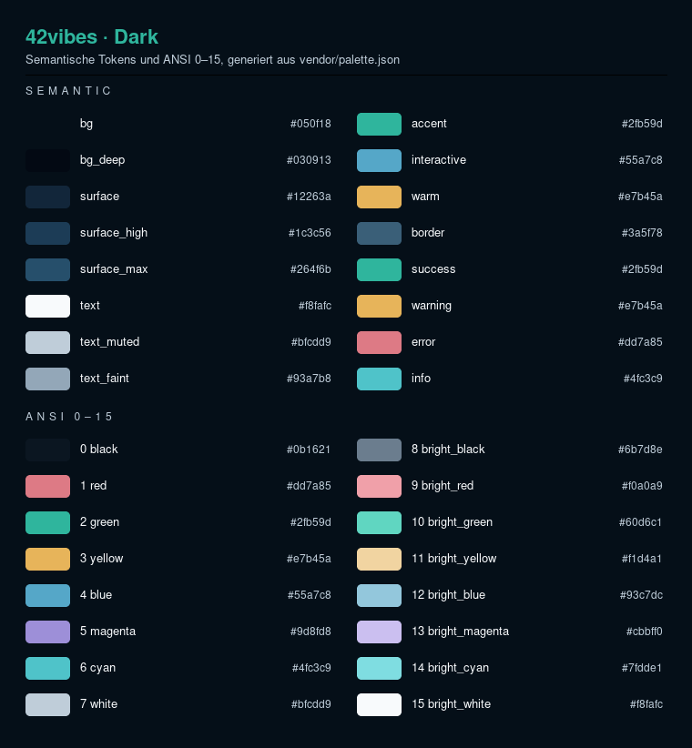
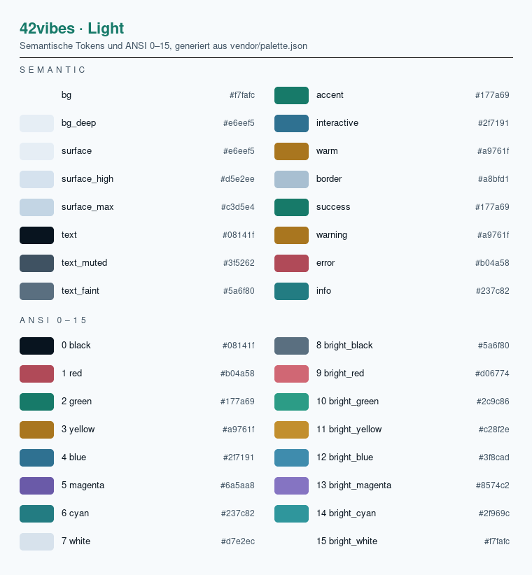
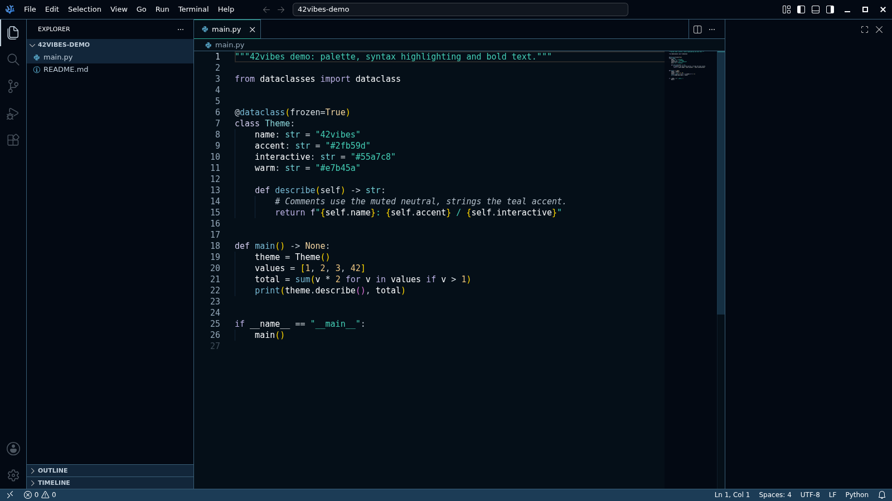
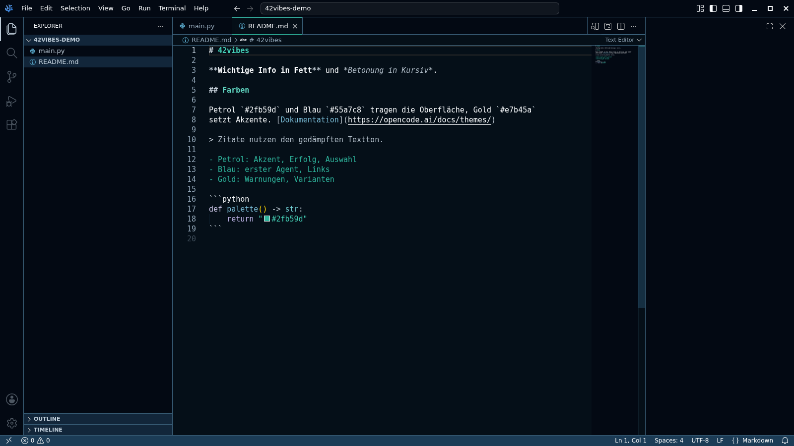
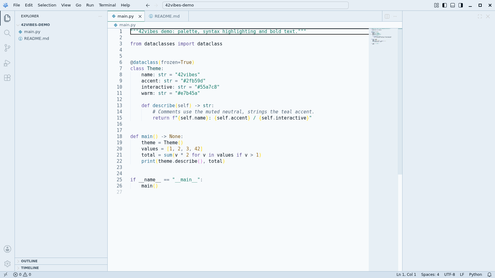
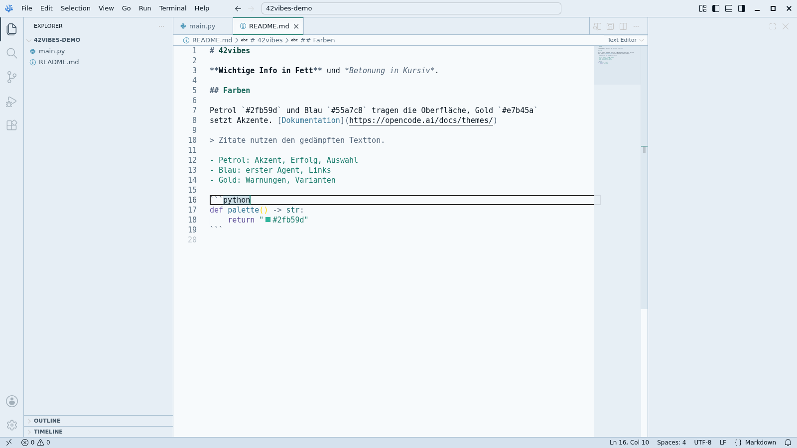
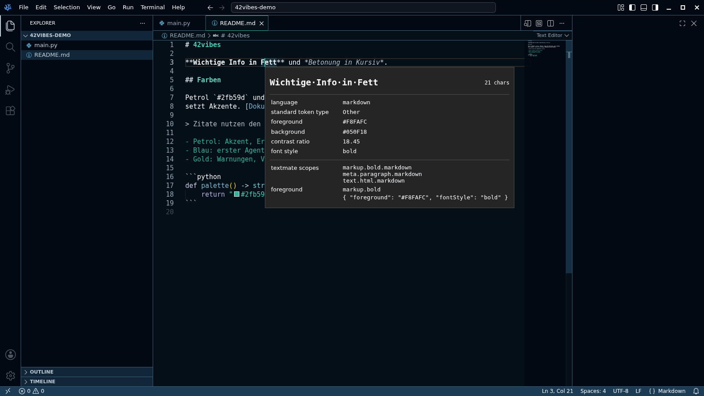

# 42vibes für VS Code

[English](README.md) · **Deutsch**

Ein VS-Code-Theme mit zwei Varianten – **42vibes** (dunkel) und
**42vibes Light** (hell) – erzeugt aus derselben Palette wie die übrigen
42vibes-Ziele (Terminal, Vim, OpenCode, Shell). Die Farben sind dadurch in
allen Werkzeugen identisch.

Die Extension enthält **nur Theme-Definitionen, keinen ausführbaren Code**:
kein `main`, keine `activationEvents`, keine Abhängigkeiten. `package.json`
ist statisch und wird nicht generiert.

<!-- palette:start -->
## Palettenvorschau

Die folgenden Bilder und Tabellen werden von `build.py` aus
`vendor/palette.json` erzeugt: generierte Vorschau, kein Screenshot.
Bitte nicht von Hand bearbeiten.

**Dark**



**Light**



### Semantische Tokens (Dark/Light)

| Token | Dark | Light |
| --- | --- | --- |
| `bg` | `#050f18` | `#f7fafc` |
| `bg_deep` | `#030913` | `#e6eef5` |
| `surface` | `#12263a` | `#e6eef5` |
| `surface_high` | `#1c3c56` | `#d5e2ee` |
| `surface_max` | `#264f6b` | `#c3d5e4` |
| `text` | `#f8fafc` | `#08141f` |
| `text_muted` | `#bfcdd9` | `#3f5262` |
| `text_faint` | `#93a7b8` | `#5a6f80` |
| `accent` | `#2fb59d` | `#177a69` |
| `interactive` | `#55a7c8` | `#2f7191` |
| `warm` | `#e7b45a` | `#a9761f` |
| `border` | `#3a5f78` | `#a8bfd1` |
| `success` | `#2fb59d` | `#177a69` |
| `warning` | `#e7b45a` | `#a9761f` |
| `error` | `#dd7a85` | `#b04a58` |
| `info` | `#4fc3c9` | `#237c82` |

### ANSI 0–15 (Dark/Light)

| Slot | Dark | Light |
| --- | --- | --- |
| 0 black | `#0b1621` | `#08141f` |
| 1 red | `#dd7a85` | `#b04a58` |
| 2 green | `#2fb59d` | `#177a69` |
| 3 yellow | `#e7b45a` | `#a9761f` |
| 4 blue | `#55a7c8` | `#2f7191` |
| 5 magenta | `#9d8fd8` | `#6a5aa8` |
| 6 cyan | `#4fc3c9` | `#237c82` |
| 7 white | `#bfcdd9` | `#d7e2ec` |
| 8 bright_black | `#6b7d8e` | `#5a6f80` |
| 9 bright_red | `#f0a0a9` | `#d06774` |
| 10 bright_green | `#60d6c1` | `#2c9c86` |
| 11 bright_yellow | `#f1d4a1` | `#c28f2e` |
| 12 bright_blue | `#93c7dc` | `#3f8cad` |
| 13 bright_magenta | `#cbbff0` | `#8574c2` |
| 14 bright_cyan | `#7fdde1` | `#2f969c` |
| 15 bright_white | `#f8fafc` | `#f7fafc` |
<!-- palette:end -->

## Screenshots

Echte Aufnahmen aus **VSCodium 1.143.17232** (Linux arm64, Xvfb, isoliertes
Profil). Installiert wurde das selbst gebaute VSIX, geöffnet ein temporäres
Demo-Verzeichnis mit einer Python-Datei und einer Markdown-Datei.

### Dark





### Light





### Fett-Nachweis

`Developer: Inspect Editor Tokens and Scopes` auf einer fetten Markdown-Passage:
Scope `markup.bold.markdown`, `fontStyle: bold`, Vordergrund `#f8fafc`.



Die Screenshots liegen unter `docs/` und sind vom VSIX ausgeschlossen.

## Installation

### Lokal aus einem VSIX

```sh
code --install-extension 42vibes-theme-0.1.0.vsix
```

Ein VSIX wird in diesem Repository **nicht** eingecheckt. Es lässt sich lokal
mit dem Befehl aus dem [Packaging-Hinweis](#packaging-hinweis) bauen; die
erzeugte Datei bleibt unversioniert (`*.vsix` steht in `.gitignore`).

### Direkter Dev-Test ohne VSIX

Aus dem Repository heraus startet VS Code mit der Extension im
Entwicklungsmodus:

```sh
code --extensionDevelopmentPath=.
```

Danach `Preferences: Color Theme` öffnen und **42vibes** bzw.
**42vibes Light** wählen. Die Theme-Dateien werden direkt aus `themes/`
geladen.

### VSCodium / Code-OSS / Open VSX

VSCodium und Code-OSS nutzen den Open-VSX-Marktplatz. Das Theme wird dort
**nicht** veröffentlicht; für den lokalen Gebrauch funktioniert derselbe
VSIX-Weg:

```sh
codium --install-extension 42vibes-theme-0.1.0.vsix
```

Alternativ `codium --extensionDevelopmentPath=.` für den Dev-Test. Eine
Veröffentlichung auf Open VSX (`ovsx publish`) ist nicht Teil dieses Repos.

## Dark/Light auswählen

* `42vibes` → `uiTheme: vs-dark`, `type: dark`
* `42vibes Light` → `uiTheme: vs`, `type: light`

VS Code schaltet beim Wechsel des Betriebssystem- oder
`workbench.colorTheme`-Modus nicht automatisch zwischen zwei separaten
Themes um; die gewünschte Variante wird explizit in den Einstellungen
gewählt:

```json
{
  "workbench.colorTheme": "42vibes"
}
```

## Terminal-ANSI-Kopplung

Das Theme setzt alle 16 ANSI-Slots (`terminal.ansiBlack` …
`terminal.ansiBrightWhite`) sowie `terminal.background`,
`terminal.foreground`, `terminal.selectionBackground` und den Cursor. Das
integrierte VS-Code-Terminal verwendet exakt diese Werte – unabhängig davon,
welches Terminal-Profil (bash, zsh, fish, …) läuft.

Damit das **externe** Terminal dieselben Farben zeigt, wird dort das
Schwester-Repository `42vibes-terminal` mit demselben
`vendor/palette.json` verwendet (kitty, alacritty, wezterm, foot, ghostty,
tmux). Die Werte sind nicht abgeschrieben, sondern stammen aus derselben
Datei; `validate.py` prüft die 16 Slots gegen `palette.ansi` der passenden
Mode. Wer die Farben im VS-Code-Terminal manuell überschreiben will, kann
das über `workbench.colorCustomizations` tun – nötig ist es nicht.

## Struktur

```text
42vibes-vscode/
├── package.json                         # statisch: Metadaten + contributes.themes
├── build.py                             # Generator (Palette -> Theme-JSONs)
├── validate.py                          # Struktur-, Farb- und Kontrastprüfung
├── Makefile                             # build / validate / package-Hinweis
├── README.md                            # Englisch
├── README.de.md                         # Deutsch
├── LICENSE
├── .gitignore
├── .vscodeignore
├── docs/                                # Screenshots (vom VSIX ausgeschlossen)
├── preview/                             # generierte Palettenvorschauen (SVG + PNG)
├── vendor/
│   └── palette.json                     # Kopie von ../42vibes-palette/palette.json
└── themes/
    ├── 42vibes-color-theme.json         # generiert, eingecheckt
    └── 42vibes-light-color-theme.json   # generiert, eingecheckt
```

`build.py` ist die einzige Quelle der Theme-JSONs; sie werden **nicht** von
Hand bearbeitet. Die Rampen entsprechen den anderen 42vibes-Zielen:

| Mode  | Schritte 100–900 (HSL-Lightness-Offsets)                  | Sättigung |
|-------|-----------------------------------------------------------|-----------|
| Dark  | +0.28, +0.16, +0.09, +0.04, 0, −0.10, −0.20, −0.30, −0.38 | ×0.55 bei 100/900 |
| Light | −0.30, −0.20, −0.12, −0.05, 0, +0.08, +0.15, +0.22, +0.28 | ×0.55 bei 100/900 |

Verwendet werden `semantic.*` für Flächen/Text, `hues.*` für Syntax und
Akzente sowie `ansi.*` unverändert für die Terminal-Slots. Die Theme-Dateien
tragen `$schema: "vscode://schemas/color-theme"`.

## Build und Validierung

```sh
python3 build.py            # schreibt Themes, SVG-/PNG-Vorschauen und Palette-Block
python3 build.py --check    # Exit 0, wenn die eingecheckten Dateien aktuell sind
python3 validate.py         # Exit 0 bei Erfolg, sonst Exit 1 mit Fehlerliste
make build                  # = python3 build.py
make validate               # = build --check + validate.py
```

`validate.py` prüft:

* beide Dateien sind valides JSON, `name` gesetzt, `type` = `dark`/`light`,
* alle geforderten Workbench-Farben vorhanden und syntaktisch gültig
  (`#RGB`, `#RGBA`, `#RRGGBB`, `#RRGGBBAA`),
* alle 16 `terminal.ansi*`-Slots vorhanden und **exakt** gleich
  `palette.ansi` der passenden Mode,
* `tokenColors` nicht leer; jeder Eintrag hat `scope` und
  `settings.foreground`,
* `bold` nur für `markup.heading*`, `markup.bold` und `invalid`,
  `italic` nur für Kommentar-Scopes und `markup.italic`,
* Kontrast der Pflichtpaare (WCAG 2.x, Relative Luminance),
* die generierten `preview/palette-*.png` existieren und beginnen mit der
  PNG-Signatur (die SVGs werden mit ImageMagick gerastert; fehlt es, behält
  `build.py` die eingecheckten PNGs und gibt einen Hinweis aus),
* beide READMEs verweisen auf die PNG-Vorschauen, enthalten keine
  SVG-Bildverweise und tragen Palette-Marker, Umschalter, Screenshot-Pfade,
  Packaging-Befehl und Lizenzhinweis,
* `package.json` nutzt `uiTheme: vs-dark` für das dunkle und `uiTheme: vs`
  (hell) für das helle Theme; die wirkungslosen Schlüssel `tab.borderTop`,
  `terminal.cursorForeground`, `panel.titleForeground` und
  `peekView.background` werden abgelehnt.

Indent-Guides: `engines.vscode` bleibt bei `^1.80.0`. Der Generator schreibt
sowohl die neuen Schlüssel (`editorIndentGuide.background1`,
`editorIndentGuide.activeBackground1`) als auch die alten Schreibweisen
(`editorIndentGuide.background`, `editorIndentGuide.activeBackground`). VS Code
1.80 hat die alten Schlüssel als veraltet markiert, wertet sie aber weiterhin
aus; ältere 1.80.x-Builds und neuere Versionen zeigen damit identische Guides.

## Kontrastwerte

Schwellen: ≥ 4.5:1 für Text, ≥ 3.0:1 für die Statusbar (UI-Text).

| Paar | Dark | Light | Schwelle |
|------|------|-------|----------|
| `editor.foreground` / `editor.background` | 18.45:1 | 17.73:1 | 4.5 |
| `list.activeSelectionForeground` / `list.activeSelectionBackground` | 10.97:1 | 14.11:1 | 4.5 |
| `statusBar.foreground` / `statusBar.background` | 10.97:1 | 14.11:1 | 3.0 |
| `terminal.foreground` / `terminal.background` | 18.45:1 | 17.73:1 | 4.5 |

Alle Pflichtpaare lagen mit den Semantikfarben bereits über den Schwellen;
**keine Farbe musste deshalb nachjustiert werden**. Bei den Syntaxfarben des
Light-Themes wurden bewusst die dunkleren Rampenstufen 300–500 gewählt
(der Light-Ramp ist gegenüber dem Dark-Ramp invertiert), damit auch Tokens
auf `#f7fafc` mindestens 4.77:1 erreichen.

## Packaging-Hinweis

Das `repository`-Feld verweist auf `https://github.com/42vibes/42vibes-vscode`;
damit löst `vsce` die relativen README-Links selbst auf. VSIX im
Repository-Wurzelverzeichnis bauen:

```sh
npx --yes @vscode/vsce package
```

Die README-Vorschauen nutzen bewusst PNG: Der Marketplace unterstützt keine
SVG-Bilder in README-Dateien. `preview/*.svg` bleibt als Quelle im Repository
und ist vom VSIX ausgeschlossen (`.vscodeignore`); nur die PNG-Vorschauen werden
gepackt. Auch `docs/` ist ausgeschlossen und löst sich auf dem Marketplace über
die Repository-URL auf.

Das Packaging wurde in einer Wegwerf-Kopie unter `/tmp` ohne Zusatzflags
verifiziert; das entstehende `42vibes-theme-0.1.0.vsix` wird nicht eingecheckt.
Das Makefile-Target `package` gibt nur den Befehl aus und installiert keine
npm-Pakete im Repository.

## Bekannte Einschränkungen

* Kein visueller Test in VS Code möglich: `command -v code` liefert in dieser
  Umgebung keinen Treffer; es wurde nichts installiert. Die Prüfung ist
  daher rein strukturell/automatisiert.
* Das Packen ist in einer sauberen `/tmp`-Kopie verifiziert, aber kein VSIX
  wird eingecheckt und es gibt keinen Git-Commit (nur `git init -b main`).
* `semanticHighlighting` ist aktiviert; die semantischen Token-Farben
  stammen aus den `hues.*`-Rampen, nicht aus einer separaten Semantik-Tabelle.

## Lizenz

MIT, Copyright 2026 42vibes. Der vollständige Text steht in [`LICENSE`](LICENSE).
