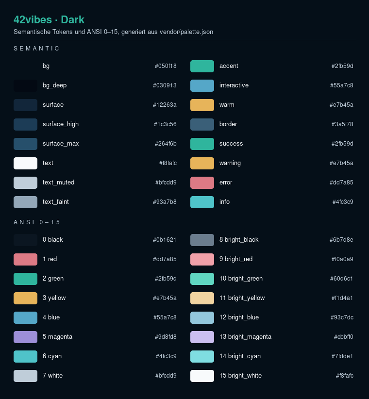
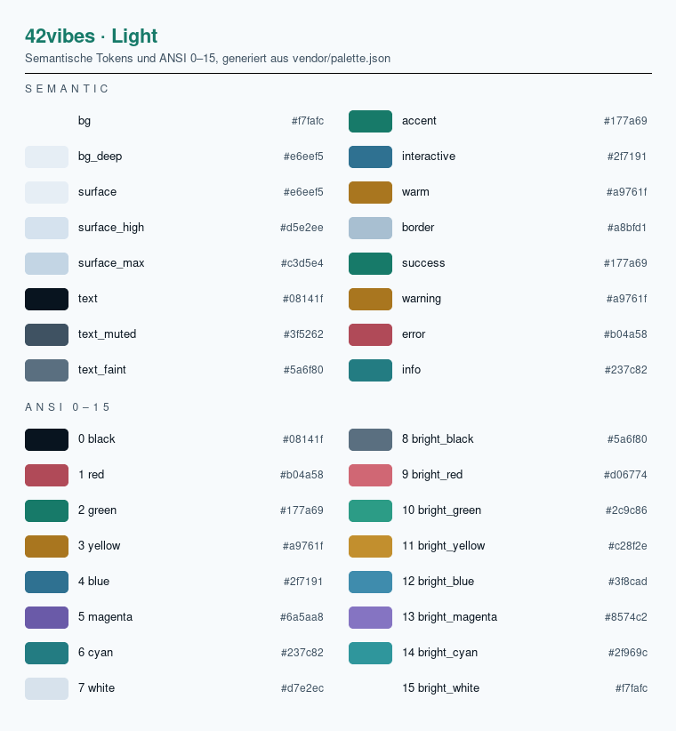
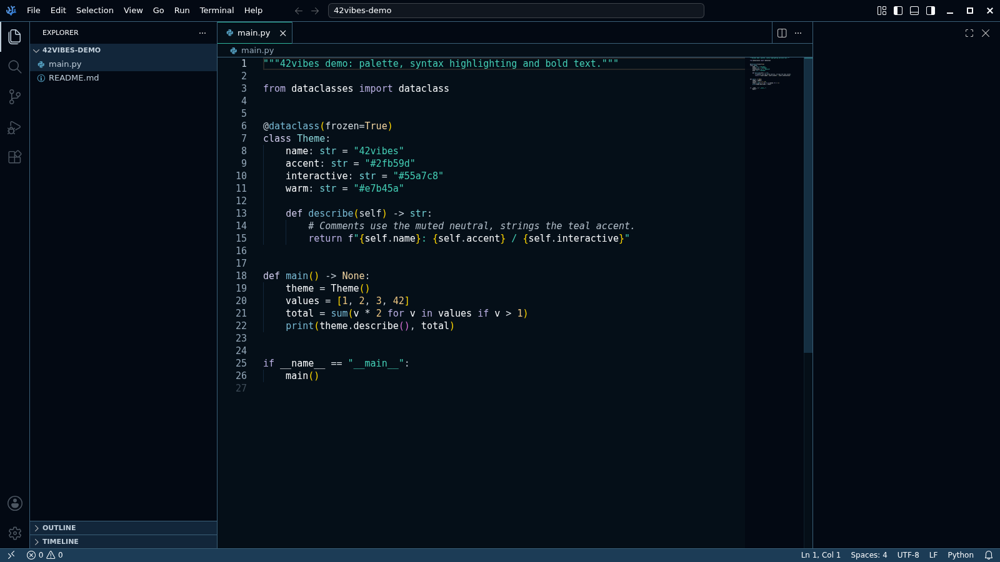
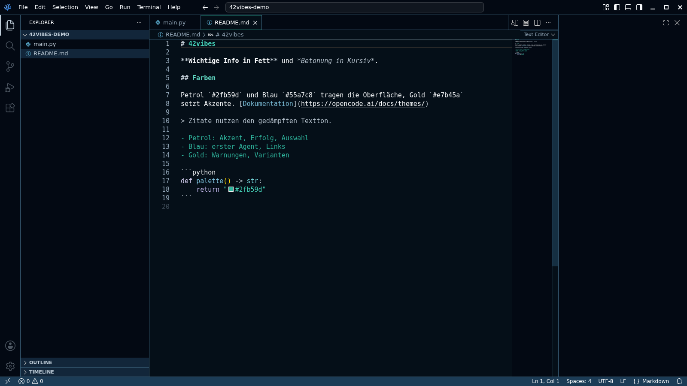
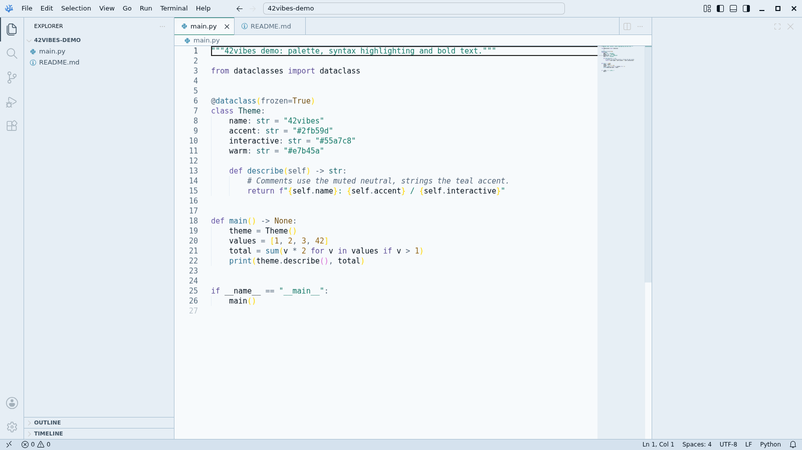
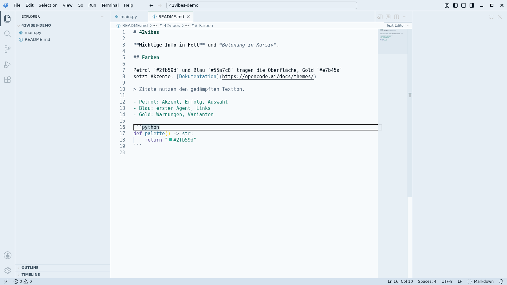
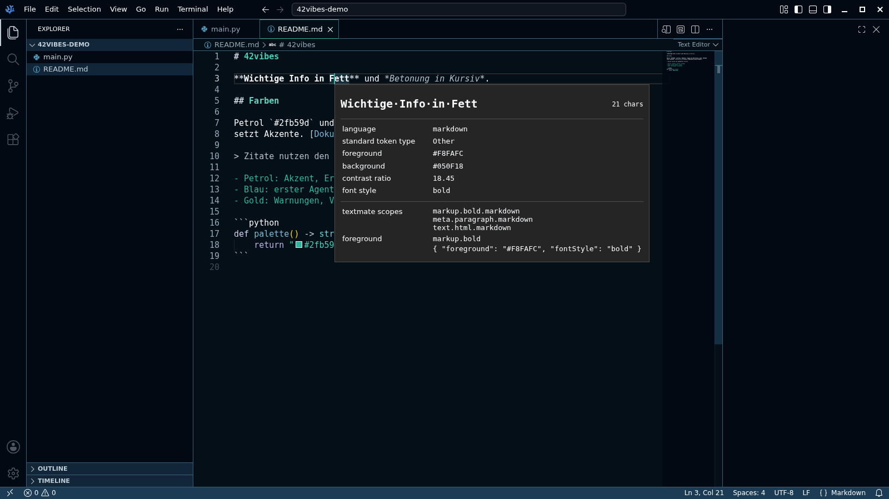

# 42vibes for VS Code

**English** · [Deutsch](README.de.md)

A VS Code theme with two variants – **42vibes** (dark) and **42vibes Light**
(light) – generated from the same palette as the other 42vibes targets
(terminal, Vim, OpenCode, shell). The colors are therefore identical across
all tools.

The extension contains **only theme definitions, no executable code**: no
`main`, no `activationEvents`, no dependencies. `package.json` is static and
is not generated.

<!-- palette:start -->
## Palette preview

The following images and tables are generated by `build.py` from
`vendor/palette.json`: generated preview, not a screenshot.
Please do not edit them by hand.

**Dark**



**Light**



### Semantic tokens (dark/light)

| Token | Dark | Light |
| --- | --- | --- |
| `bg` | `#050f18` | `#f7fafc` |
| `bg_deep` | `#030913` | `#e6eef5` |
| `surface` | `#12263a` | `#e6eef5` |
| `surface_high` | `#1c3c56` | `#d5e2ee` |
| `surface_max` | `#264f6b` | `#c3d5e4` |
| `text` | `#f8fafc` | `#08141f` |
| `text_muted` | `#bfcdd9` | `#3f5262` |
| `text_faint` | `#93a7b8` | `#5a6f80` |
| `accent` | `#2fb59d` | `#177a69` |
| `interactive` | `#55a7c8` | `#2f7191` |
| `warm` | `#e7b45a` | `#a9761f` |
| `border` | `#3a5f78` | `#a8bfd1` |
| `success` | `#2fb59d` | `#177a69` |
| `warning` | `#e7b45a` | `#a9761f` |
| `error` | `#dd7a85` | `#b04a58` |
| `info` | `#4fc3c9` | `#237c82` |

### ANSI 0–15 (dark/light)

| Slot | Dark | Light |
| --- | --- | --- |
| 0 black | `#0b1621` | `#08141f` |
| 1 red | `#dd7a85` | `#b04a58` |
| 2 green | `#2fb59d` | `#177a69` |
| 3 yellow | `#e7b45a` | `#a9761f` |
| 4 blue | `#55a7c8` | `#2f7191` |
| 5 magenta | `#9d8fd8` | `#6a5aa8` |
| 6 cyan | `#4fc3c9` | `#237c82` |
| 7 white | `#bfcdd9` | `#d7e2ec` |
| 8 bright_black | `#6b7d8e` | `#5a6f80` |
| 9 bright_red | `#f0a0a9` | `#d06774` |
| 10 bright_green | `#60d6c1` | `#2c9c86` |
| 11 bright_yellow | `#f1d4a1` | `#c28f2e` |
| 12 bright_blue | `#93c7dc` | `#3f8cad` |
| 13 bright_magenta | `#cbbff0` | `#8574c2` |
| 14 bright_cyan | `#7fdde1` | `#2f969c` |
| 15 bright_white | `#f8fafc` | `#f7fafc` |
<!-- palette:end -->

## Screenshots

Real captures from **VSCodium 1.143.17232** (Linux arm64, Xvfb, isolated
profile). The self-built VSIX was installed, and a temporary demo directory
with a Python file and a Markdown file was opened.

### Dark





### Light





### Bold proof

`Developer: Inspect Editor Tokens and Scopes` on a bold Markdown passage:
scope `markup.bold.markdown`, `fontStyle: bold`, foreground `#f8fafc`.



The screenshots live in `docs/` and are excluded from the VSIX.

## Installation

### Locally from a VSIX

```sh
npx --yes @vscode/vsce package
code --install-extension 42vibes-theme-0.1.0.vsix
```

For VSCodium use `codium --install-extension 42vibes-theme-0.1.0.vsix`
instead. This repository does **not** commit a VSIX; the generated file stays
untracked (`*.vsix` is in `.gitignore`).

### Direct dev test without a VSIX

From the repository, VS Code starts with the extension in development mode:

```sh
code --extensionDevelopmentPath=.
```

Then open `Preferences: Color Theme` and choose **42vibes** or
**42vibes Light**. The theme files are loaded directly from `themes/`.

### VSCodium / Code-OSS / Open VSX

VSCodium and Code-OSS use the Open VSX marketplace. The theme is **not**
published there; for local use the same VSIX path works:

```sh
codium --install-extension 42vibes-theme-0.1.0.vsix
```

Alternatively `codium --extensionDevelopmentPath=.` for the dev test.
Publishing to Open VSX (`ovsx publish`) is not part of this repo.

## Choosing dark/light

* `42vibes` → `uiTheme: vs-dark`, `type: dark`
* `42vibes Light` → `uiTheme: vs`, `type: light`

VS Code does not automatically switch between two separate themes when the
operating system or `workbench.colorTheme` mode changes; the desired variant
is chosen explicitly in the settings:

```json
{
  "workbench.colorTheme": "42vibes"
}
```

## Terminal ANSI coupling

The theme sets all 16 ANSI slots (`terminal.ansiBlack` …
`terminal.ansiBrightWhite`) as well as `terminal.background`,
`terminal.foreground`, `terminal.selectionBackground` and the cursor. The
integrated VS Code terminal uses exactly these values – regardless of which
terminal profile (bash, zsh, fish, …) is running.

For the **external** terminal to show the same colors, the sibling repository
`42vibes-terminal` with the same `vendor/palette.json` is used there (kitty,
alacritty, wezterm, foot, ghostty, tmux). The values are not copied by hand;
they come from the same file; `validate.py` checks the 16 slots against
`palette.ansi` of the matching mode. If you want to override the colors in the
VS Code terminal manually, you can do so via `workbench.colorCustomizations` –
it is not necessary.

## Structure

```text
42vibes-vscode/
├── package.json                         # static: metadata + contributes.themes
├── build.py                             # generator (palette -> theme JSONs)
├── validate.py                          # structure, color and contrast checks
├── Makefile                             # build / validate / package note
├── README.md                            # English
├── README.de.md                         # German
├── LICENSE
├── .gitignore
├── .vscodeignore
├── docs/                                # screenshots (excluded from the VSIX)
├── preview/                             # generated palette previews (SVG + PNG)
├── vendor/
│   └── palette.json                     # copy of ../42vibes-palette/palette.json
└── themes/
    ├── 42vibes-color-theme.json         # generated, checked in
    └── 42vibes-light-color-theme.json   # generated, checked in
```

`build.py` is the only source of the theme JSONs; they are **not** edited by
hand. The ramps match the other 42vibes targets:

| Mode  | Steps 100–900 (HSL lightness offsets)                      | Saturation |
|-------|------------------------------------------------------------|------------|
| Dark  | +0.28, +0.16, +0.09, +0.04, 0, −0.10, −0.20, −0.30, −0.38 | ×0.55 at 100/900 |
| Light | −0.30, −0.20, −0.12, −0.05, 0, +0.08, +0.15, +0.22, +0.28 | ×0.55 at 100/900 |

`semantic.*` is used for surfaces/text, `hues.*` for syntax and accents, and
`ansi.*` unchanged for the terminal slots. The theme files carry
`$schema: "vscode://schemas/color-theme"`.

## Build and validation

```sh
python3 build.py            # writes themes, SVG/PNG previews and the palette block
python3 build.py --check    # exit 0 if the checked-in files are current
python3 validate.py         # exit 0 on success, otherwise exit 1 with errors
make build                  # = python3 build.py
make validate               # = build --check + validate.py
```

`validate.py` checks:

* both files are valid JSON, `name` is set, `type` = `dark`/`light`,
* all required workbench colors are present and syntactically valid
  (`#RGB`, `#RGBA`, `#RRGGBB`, `#RRGGBBAA`),
* all 16 `terminal.ansi*` slots are present and **exactly** equal to
  `palette.ansi` of the matching mode,
* `tokenColors` is not empty; every entry has `scope` and
  `settings.foreground`,
* `bold` only for `markup.heading*`, `markup.bold` and `invalid`,
  `italic` only for comment scopes and `markup.italic`,
* contrast of the required pairs (WCAG 2.x, relative luminance),
* the generated `preview/palette-*.png` files exist and start with the PNG
  signature (the SVGs are rendered by ImageMagick; if it is unavailable,
  `build.py` keeps the checked-in PNGs and prints a warning),
* both READMEs reference the PNG previews, contain no SVG image references,
  carry the palette markers, switcher, screenshot paths, packaging command
  and license notice,
* `package.json` uses `uiTheme: vs-dark` for the dark theme and
  `uiTheme: vs` (light) for the light theme; the non-functional keys
  `tab.borderTop`, `terminal.cursorForeground`, `panel.titleForeground` and
  `peekView.background` are rejected.

Indent guides: `engines.vscode` stays at `^1.80.0`. The generator emits both
the new keys (`editorIndentGuide.background1`,
`editorIndentGuide.activeBackground1`) and the legacy spellings
(`editorIndentGuide.background`, `editorIndentGuide.activeBackground`). VS Code
1.80 deprecated the legacy keys but still honours them, so older 1.80.x builds
and newer releases show identical guides.

## Contrast values

Thresholds: ≥ 4.5:1 for text, ≥ 3.0:1 for the status bar (UI text).

| Pair | Dark | Light | Threshold |
|------|------|-------|-----------|
| `editor.foreground` / `editor.background` | 18.45:1 | 17.73:1 | 4.5 |
| `list.activeSelectionForeground` / `list.activeSelectionBackground` | 10.97:1 | 14.11:1 | 4.5 |
| `statusBar.foreground` / `statusBar.background` | 10.97:1 | 14.11:1 | 3.0 |
| `terminal.foreground` / `terminal.background` | 18.45:1 | 17.73:1 | 4.5 |

All required pairs were already above the thresholds with the semantic
colors; **no color had to be adjusted** for that reason. For the light theme's
syntax colors, the darker ramp steps 300–500 were deliberately chosen (the
light ramp is inverted relative to the dark ramp), so that tokens on `#f7fafc`
also reach at least 4.77:1.

## Packaging note

The `repository` field points at `https://github.com/42vibes/42vibes-vscode`, so
`vsce` resolves the relative README links itself. Build the VSIX from the
repository root:

```sh
npx --yes @vscode/vsce package
```

The README previews use PNG on purpose: the Marketplace does not support SVG
images in README files. `preview/*.svg` stays in the repository as the source
and is excluded from the VSIX (`.vscodeignore`); only the PNG previews are
packaged. Screenshots under `docs/` are excluded as well and resolve through the
repository URL on the Marketplace.

Packaging was verified in a throwaway copy under `/tmp` without extra flags; the
resulting `42vibes-theme-0.1.0.vsix` is not committed. The Makefile target
`package` only prints the command; it never installs npm packages into this
repository.

## Known limitations

* No visual test in VS Code possible: `command -v code` returns no match in
  this environment; nothing was installed. The check is therefore purely
  structural/automated.
* Packaging is verified in a clean `/tmp` copy, but no VSIX is committed and
  no Git commit exists (only `git init -b main`).
* `semanticHighlighting` is enabled; the semantic token colors come from the
  `hues.*` ramps, not from a separate semantic table.

## License

MIT, Copyright 2026 42vibes. The full text is in [`LICENSE`](LICENSE).
